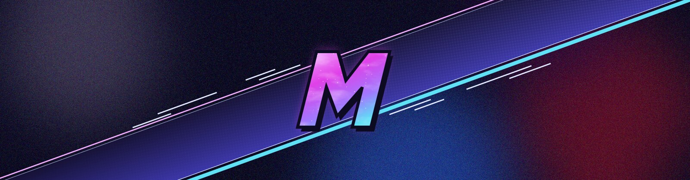

  

<h1 align="center">Hey, I'm Marukooh 👋</h1>

  Software developer at <a href="https://github.com/AlmavivA">@AlmavivA</a> · Linux tinkerer · I build tools for the games I play

---

### 🛠️ What I'm building

- 🔍 **[LogAnalyzer](https://github.com/Marukooh/LogAnalyzer)**: a fast native log viewer for huge files, with multi-core search, severity/timestamp filters and follow mode. *C++ · Qt/QML*
- 🛰️ **[Archon's Eye](https://github.com/Marukooh/Archons-Eye)**: an Elite Dangerous scanner that finds high-value trader and miner traffic systems. *Python*
- 🎮 **[WFHelper](https://github.com/Marukooh/WFHelper)**: a desktop Warframe companion with inventory, relic reward scanner, warframe.market prices, mastery and world state. *TypeScript · Svelte*
- 🧩 **Game mods**: e.g. configurable artifact challenges for Crimson Desert

### 🐧 Linux desktop fixes

I daily-drive **CachyOS + KDE Plasma 6** and patch whatever breaks along the way:

- **[venmic](https://github.com/Marukooh/venmic)**: fixing a crash in Discord/Vesktop screen-share audio over PipeWire
- **[SwayNotificationCenter](https://github.com/Marukooh/SwayNotificationCenter)** and **[MangoHud](https://github.com/Marukooh/MangoHud)**: tweaks for my setup
- Custom Plasma widgets, a violet theme everywhere, and too many systemd user services

### 🧰 Tech stack

  
  
  
  
  
  
  
  
  
  

### 🎮 Currently playing

Warframe · Elite Dangerous · Crimson Desert · ACE COMBAT 8 · AION 2

### 📊 Stats

  
  

