  

  
  
  

  

  
  
  
  
  
  

I daily-drive **CachyOS + KDE Plasma 6** and patch whatever breaks along the way:

- 🔎 **[vkd3d-autopsy](https://github.com/Marukooh/vkd3d-autopsy)**: tracked a Crimson Desert GPU hang on NVIDIA Blackwell down to a single shader and a never-mapped address ([vkd3d-proton#3444](https://github.com/HansKristian-Work/vkd3d-proton/issues/3444))
- 🎧 **[vesktop-patches](https://github.com/Marukooh/vesktop-patches)** and **[venmic](https://github.com/Marukooh/venmic)**: Discord/Vesktop screen-share quality and PipeWire audio fixes
- 🔔 **[SwayNotificationCenter](https://github.com/Marukooh/SwayNotificationCenter)** and **[MangoHud](https://github.com/Marukooh/MangoHud)**: tweaks for my setup
- 💜 Custom Plasma widgets, a violet glass theme everywhere, and too many systemd user services

  
  
  
  
  
  
  
  
  
  
  

  

  

  

